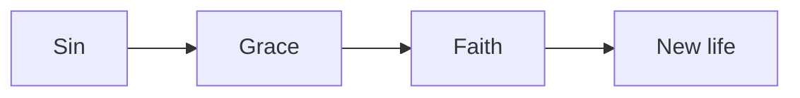
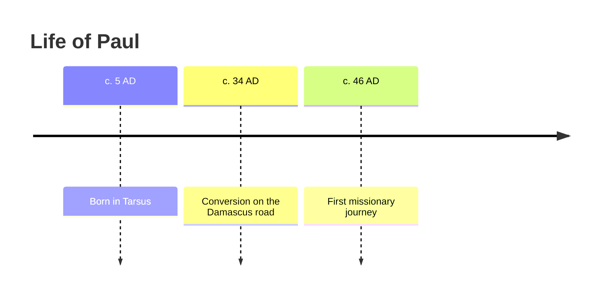
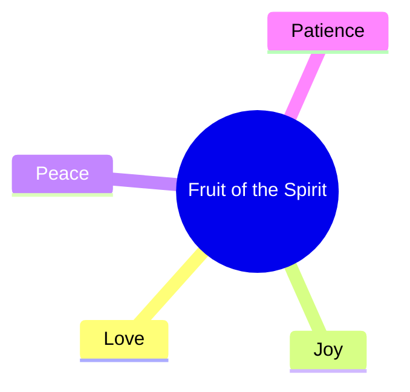
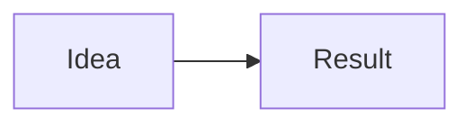

# How to Write Notes for MyNotes

> [!IMPORTANT]
> One `.md` file = one lesson. `#` is the lesson title, `##` are sections (they become slides, table-of-contents entries and mind-map branches), `###` are sub-points.

## Quick Reference

| You want | Write this |
|---|---|
| Lesson settings | Front matter between `---` lines at the very top |
| Lesson title | `# Title` (only one per file) |
| Section / slide | `## Section` |
| Sub-point | `### Sub-point` |
| Callout box | `> [!NOTE]` `> [!TIP]` `> [!IMPORTANT]` `> [!WARNING]` `> [!EXAMPLE]` |
| Key term with definition | `==term==` + a `## Glossary` section |
| Self-check question | `Q:` line followed by `A:` line |
| Hidden / expandable content | `<details><summary>Title</summary> … </details>` |
| Tabs | `::: tabs` … `### Tab name` … `:::` |
| Interactive steps | a `## Steps` heading + numbered list |
| Diagram | ` ```mermaid ` code block |
| Bible verse link | `John 3:16` (auto-detected) or `[[John 3:16]]` |
| Full scripture card | ` ```verse ` code block with the reference |
| Compare translations | ` ```verse KJV,NIV ` |
| Link to another lesson | `[[Lesson Title]]` |
| Checklist | `- [ ] item` |

## 1. Front Matter (lesson settings)

Always the first thing in the file:

```text
---
title: Grace and Faith
course: Romans Study
order: 3
tags: [grace, salvation, paul]
bible: NIV
---
```

- `title` overrides the `#` heading if different
- `course` and `order` place the lesson automatically when uploaded
- `bible` overrides the course translation for this lesson only (leave it out to use the course default)

## 2. Structure: Headings

- One `#` per file.
- Use `##` for each main idea. Keep a section to what fits on **one slide**: roughly 3–6 bullets or 1–2 short paragraphs.
- Use `###` for sub-points inside a section.
- Don't skip levels (`#` straight to `###`), or the mind map breaks.

> [!TIP]
> Write section headings as short phrases (2–6 words). They show up in the table of contents, the mind map and slide titles.

## 3. Callouts

```text
> [!NOTE]
> Background information.

> [!TIP]
> A helpful insight or application.

> [!IMPORTANT]
> The one thing to remember. (Shows inverted: black box, white text.)

> [!WARNING]
> A common mistake or misunderstanding.

> [!EXAMPLE]
> A story, illustration or worked example.
```

Use at most 1–2 IMPORTANT callouts per lesson so they stay special.

## 4. Key Terms and Glossary

Mark a term the first time it appears:

```text
Paul teaches that we are saved through ==justification== by faith.
```

Define it at the end of the file:

```text
## Glossary
- justification: being declared righteous before God
- grace: God's unearned favor
```

The term must match exactly (same spelling) in the text and the glossary.

## 5. Self-Check Questions

```text
Q: What does Romans 5:1 say we have with God?
A: Peace, through our Lord Jesus Christ.
```

- Put 1–3 after each main section, or collect them in a `## Review` section at the end.
- Keep answers to 1–2 sentences. These also feed quizzes and flashcards.

## 6. Expandable Content

For optional depth that shouldn't interrupt reading:

```text
<details>
<summary>Historical background</summary>

Rome had a large Jewish and Gentile church...

</details>
```

Leave a blank line after `<summary>` and before `</details>` so the Markdown inside renders.

## 7. Tabs

Great for comparisons or multiple viewpoints:

```text
::: tabs
### Old Testament
The law was written on stone.

### New Testament
The law is written on the heart (Jer 31:33, Heb 8:10).
:::
```

## 8. Steps

Any heading containing the word **Steps** turns its numbered list into an interactive stepper:

```text
## Steps to Study a Passage
1. Read the passage twice
2. Note repeated words
3. Ask what it meant then
4. Ask what it means now
```

## 9. Diagrams (Mermaid)

Flowchart:

```text

```

Timeline:

```text

```

Mind map:

```text

```

> [!WARNING]
> In Mermaid, put labels containing parentheses, colons or quotes inside double quotes: `A["Faith (pistis)"]`. Otherwise the diagram won't render.

## 10. Bible References

**Inline references** are detected automatically. Write them normally:

```text
Paul says this clearly (Eph 2:8-9), and James adds balance (James 2:17).
```

Accepted formats: `John 3:16`, `Jn 3:16`, `1 Cor 13:4-7`, `Romans 8:28, 38-39`, `Psalm 23`, `Gen 1:1–2:3`.

**Force a verse link** when detection might miss it:

```text
[[John 3:16]]
```

**Full scripture card** (use for the main passage of each section):

```text
```verse
Romans 5:1-2
```
```

**Compare translations side by side:**

```text
```verse KJV,NIV
Romans 5:1
```
```

> [!TIP]
> Always include the chapter and verse. `Romans 5` alone opens the whole chapter; `Romans` alone isn't detected.

## 11. Links Between Lessons

```text
See [[Grace and Faith]] for the foundation of this idea.
```

The text inside `[[ ]]` must match the other lesson's title exactly. These links build your knowledge graph and the "Linked from" section.

> [!NOTE]
> `[[John 3:16]]` becomes a verse; `[[Grace and Faith]]` becomes a lesson link. MyNotes tells them apart by the reference format.

## 12. Other Elements

Tables for comparisons, `- [ ]` checklists for applications, images with ``, and `---` for a visual break.

## Full Lesson Template

Copy this and fill it in:

````text
---
title: LESSON TITLE
course: COURSE NAME
order: 1
tags: [tag1, tag2]
---

# LESSON TITLE

> [!IMPORTANT]
> The single main idea of this lesson in one or two sentences.

## Introduction
Short opening paragraph. Mark the first ==key term== you use.

```verse
Book 1:1-3
```

## First Main Point
Two or three short paragraphs or 3–6 bullets. Reference verses inline (John 1:1).

> [!EXAMPLE]
> An illustration or story.

Q: A question about this section?
A: Its short answer.

## Second Main Point

::: tabs
### View A
Explanation.

### View B
Explanation.
:::



## Steps to Apply
1. First action
2. Second action
3. Third action

## Summary
- Takeaway one
- Takeaway two
- Takeaway three

## Review
Q: Review question one?
A: Answer one.

Q: Review question two?
A: Answer two.

Related: [[Another Lesson Title]]

## Glossary
- key term: its definition
````

## Checklist Before Uploading

- [ ] Front matter at the very top
- [ ] Only one `#` heading
- [ ] Each `##` section fits on one slide
- [ ] Main passage in a `verse` block
- [ ] Key terms marked with `==` and defined in the Glossary
- [ ] At least 3 `Q:` / `A:` pairs
- [ ] At least one diagram, tab set or steps list
- [ ] `[[Lesson links]]` match exact titles

## AI Conversion Prompt

Paste this into Claude (or another AI), followed by your existing notes, to convert them into MyNotes format:

````text
Convert my notes below into a MyNotes lesson in Markdown. Keep ALL of my original content and meaning — reorganize and format it, don't remove my ideas or add new teaching. Do not quote Bible text; only write references.

Follow these rules exactly:

1. Start with front matter:
   ---
   title: (clear lesson title)
   course: (course name if I mention one, otherwise leave blank)
   order: 1
   tags: [3–5 lowercase topic tags]
   ---
2. One "# Title". Split content into "## Sections" of 2–6 words each, each short enough for one slide (3–6 bullets or 1–2 short paragraphs). Use "###" for sub-points. Never skip heading levels.
3. Right after the title, add a "> [!IMPORTANT]" callout with the main idea in 1–2 sentences.
4. Use callouts where they fit: "> [!NOTE]" background, "> [!TIP]" application, "> [!WARNING]" common mistakes, "> [!EXAMPLE]" illustrations. Max 2 IMPORTANT callouts.
5. Mark key terms with ==term== on first use, and add a "## Glossary" section at the very end with "- term: definition" lines (term spelled exactly the same).
6. Bible references: write them in standard form with chapter and verse (e.g., "Eph 2:8-9", "1 Cor 13:4-7"). For the main passage of a section, use a code block with language "verse" containing only the reference. Where comparing translations helps, use ```verse KJV,NIV.
7. When content is a process or sequence, use a heading containing "Steps" with a numbered list.
8. When content compares two or more views, use:
   ::: tabs
   ### Name
   content
   :::
9. Add at least one ```mermaid diagram (flowchart, timeline or mindmap) where it clarifies relationships, order or history. Put labels with parentheses, colons or quotes in double quotes.
10. Put optional background or deep detail inside <details><summary>Title</summary> … </details>, with blank lines inside.
11. After major sections add 1–2 self-check questions:
    Q: question
    A: 1–2 sentence answer
    Then add a "## Summary" (3–5 bullet takeaways) and a "## Review" section with 3–5 more Q:/A: pairs.
12. If my notes mention other lessons or topics I've written about, link them as [[Exact Title]].
13. Output only the Markdown, in one code block, nothing before or after.

My notes:
[PASTE YOUR NOTES HERE]
````

For several files at once, add this line to the prompt: *"I'm pasting several notes; return each as a separate lesson in its own code block, all with the same course name, numbered with order: 1, 2, 3…"*

## Glossary
- front matter: the settings block between `---` lines at the top of a lesson file
- callout: a highlighted box for notes, tips or warnings