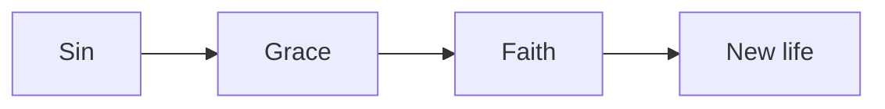
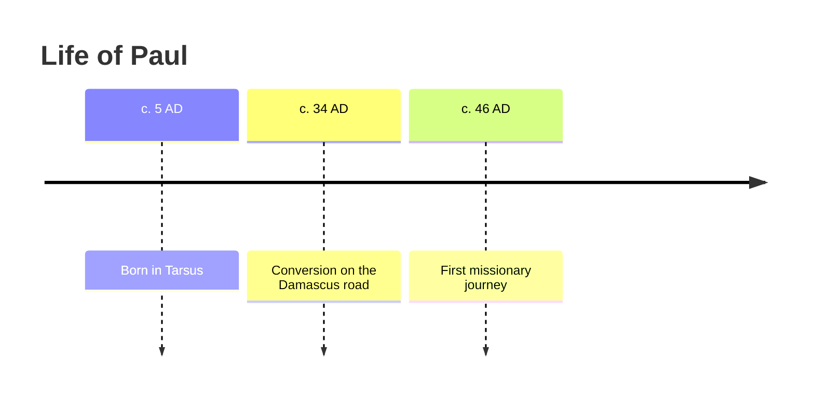
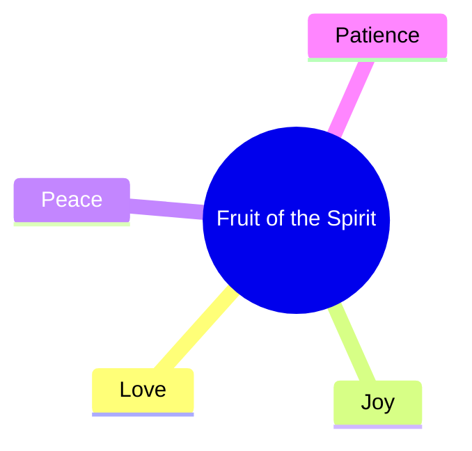

# How to Write Notes for MyNotes

> [!IMPORTANT]
> One `.md` file = one lesson. `#` is the lesson title, `##` are sections (they become slides, table-of-contents entries and mind-map branches), `###` are sub-points.

## Quick Reference

| You want | Write this |
|---|---|
| Lesson settings | Front matter between `---` lines at the very top |
| Lesson title | `# Title` (only one per file) |
| Section / slide | `## Section` |
| Sub-point | `### Sub-point` |
| Callout box | `> [!NOTE]` `> [!TIP]` `> [!IMPORTANT]` `> [!WARNING]` `> [!EXAMPLE]` |
| Key term with definition | `==term==` + a `## Glossary` section |
| Self-check question | `Q:` line followed by `A:` line |
| Hidden / expandable content | `<details><summary>Title</summary> … </details>` |
| Tabs | `::: tabs` … `### Tab name` … `:::` |
| Interactive steps | a `## Steps` heading + numbered list |
| Diagram | ` ```mermaid ` code block |
| Bible verse link | `John 3:16` (auto-detected) or `[[John 3:16]]` |
| Full scripture card | ` ```verse ` code block with the reference |
| Compare translations | ` ```verse KJV,NIV ` |
| Link to another lesson | `[[Lesson Title]]` |
| Checklist | `- [ ] item` |

## 1. Front Matter (lesson settings)

Always the first thing in the file:

```text
---
title: Grace and Faith
course: Romans Study
order: 3
tags: [grace, salvation, paul]
bible: NIV
---
```

- `title` overrides the `#` heading if different
- `course` and `order` place the lesson automatically when uploaded
- `bible` overrides the course translation for this lesson only (leave it out to use the course default)

## 2. Structure: Headings

- One `#` per file.
- Use `##` for each main idea. Keep a section to what fits on **one slide**: roughly 3–6 bullets or 1–2 short paragraphs.
- Use `###` for sub-points inside a section.
- Don't skip levels (`#` straight to `###`), or the mind map breaks.

> [!TIP]
> Write section headings as short phrases (2–6 words). They show up in the table of contents, the mind map and slide titles.

## 3. Callouts

```text
> [!NOTE]
> Background information.

> [!TIP]
> A helpful insight or application.

> [!IMPORTANT]
> The one thing to remember. (Shows inverted: black box, white text.)

> [!WARNING]
> A common mistake or misunderstanding.

> [!EXAMPLE]
> A story, illustration or worked example.
```

Use at most 1–2 IMPORTANT callouts per lesson so they stay special.

## 4. Key Terms and Glossary

Mark a term the first time it appears:

```text
Paul teaches that we are saved through ==justification== by faith.
```

Define it at the end of the file:

```text
## Glossary
- justification: being declared righteous before God
- grace: God's unearned favor
```

The term must match exactly (same spelling) in the text and the glossary.

## 5. Self-Check Questions

```text
Q: What does Romans 5:1 say we have with God?
A: Peace, through our Lord Jesus Christ.
```

- Optional, and only for questions you want to quiz yourself on. Class notes made by the AI don't add them.
- Don't copy the questions asked in class into your notes. If the lecturer asked something to teach a point and answered it, write the answer as a normal bullet.
- Keep answers to 1–2 sentences. These also feed quizzes and flashcards.

## 6. Expandable Content

For optional depth that shouldn't interrupt reading:

```text
<details>
<summary>Historical background</summary>

Rome had a large Jewish and Gentile church...

</details>
```

Leave a blank line after `<summary>` and before `</details>` so the Markdown inside renders.

## 7. Tabs

Great for comparisons or multiple viewpoints:

```text
::: tabs
### Old Testament
The law was written on stone.

### New Testament
The law is written on the heart (Jer 31:33, Heb 8:10).
:::
```

## 8. Steps

Any heading containing the word **Steps** turns its numbered list into an interactive stepper:

```text
## Steps to Study a Passage
1. Read the passage twice
2. Note repeated words
3. Ask what it meant then
4. Ask what it means now
```

## 9. Diagrams (Mermaid)

Flowchart:

```text

```

Timeline:

```text

```

Mind map:

```text

```

> [!WARNING]
> In Mermaid, put labels containing parentheses, colons or quotes inside double quotes: `A["Faith (pistis)"]`. Otherwise the diagram won't render.

## 10. Bible References

**Inline references** are detected automatically. Write them normally:

```text
Paul says this clearly (Eph 2:8-9), and James adds balance (James 2:17).
```

Accepted formats: `John 3:16`, `Jn 3:16`, `1 Cor 13:4-7`, `Romans 8:28, 38-39`, `Psalm 23`, `Gen 1:1–2:3`.

**Force a verse link** when detection might miss it:

```text
[[John 3:16]]
```

**Full scripture card** (use for the main passage of each section):

```text
```verse
Romans 5:1-2
```
```

**Compare translations side by side:**

```text
```verse KJV,NIV
Romans 5:1
```
```

> [!TIP]
> Always include the chapter and verse. `Romans 5` alone opens the whole chapter; `Romans` alone isn't detected.

## 11. Links Between Lessons

```text
See [[Grace and Faith]] for the foundation of this idea.
```

The text inside `[[ ]]` must match the other lesson's title exactly. These links build your knowledge graph and the "Linked from" section.

> [!NOTE]
> `[[John 3:16]]` becomes a verse; `[[Grace and Faith]]` becomes a lesson link. MyNotes tells them apart by the reference format.

## 12. Other Elements

Tables for comparisons, `- [ ]` checklists for applications, images with ``, and `---` for a visual break.

## Writing Notes That Read Well

A good lesson reads like a clear, friendly study page, not a form to fill in.

- **Lead with the point.** Start each section with one or two sentences that say what it's about and why it matters, then the bullets.
- **One idea per bullet.** Bold the key phrase (**sheep first**) so the eye can skim; keep bullets to one or two lines.
- **Keep the life in it.** The lecturer's own striking words, a story or example they told, a quote with who said it, a book with its *title*: these are what make notes memorable. Keep them.
- **Cut the noise.** Leave out greetings, attendance, tech trouble, "any questions?", repeated points, filler and anything said only to fill time.
- **Extras only when they help.** A diagram when there's a real relationship or sequence to see; steps when there's a real process; tabs when two views are compared; a verse block for a passage that's central. Never add one just to have it.
- **Short beats long.** A lesson should read in 5–10 minutes. Five clear sections beat ten thin ones.

## Full Lesson Template

Copy this and fill it in (leave out any part that doesn't fit the lecture):

````text
---
title: LESSON TITLE
course: COURSE NAME
order: 1
---

# LESSON TITLE

> [!IMPORTANT]
> The single main idea of this lesson in one or two sentences.

## A Heading That Says Something
One or two sentences: what this part is about and why it matters.

- **Key phrase**: the point, in the lecturer's words where they were striking.
- **Another key phrase**: a ==key term== explained the way the lecturer explained it.
- Henri Nouwen, *Spiritual Direction*: the idea credited to the book.

> [!EXAMPLE]
> The story or case the lecturer told, in two or three sentences.

## The Next Idea in the Order Taught
- **Key phrase**: the point.
- **Key phrase**: the point (John 10:11).

> "A memorable line the lecturer said or read out."
> — Who said it

## Steps to Apply (only if the lecture gave a process)
1. First action
2. Second action

## Summary
- Takeaway one
- Takeaway two
- Takeaway three

## Glossary
- key term: its meaning, as explained in class
````

## Checklist Before Uploading

- [ ] Front matter at the very top, and only one `#` heading
- [ ] An IMPORTANT callout with the main idea
- [ ] Each `##` section opens with why it matters and fits on one slide
- [ ] The lecturer's examples, stories, quotes and sources are kept
- [ ] No filler, repeats or class logistics
- [ ] Key terms marked with `==` and defined in the Glossary
- [ ] A short Summary at the end

## AI Conversion Prompt

Paste this into Claude (or another AI), followed by your existing notes, to convert them into MyNotes format:

````text
Turn my notes and the lecture below into one MyNotes lesson in Markdown: a clear, well-formatted, lively study page I'll enjoy reading and can review in 5-10 minutes. Keep all of the real content and meaning; reorganize and polish it, but don't add teaching that isn't in the material. Do not quote Bible text; only write references.

FORMAT (MyNotes Markdown):
1. Front matter first:
   ---
   title: (a clear lesson title)
   course: (course name if given, otherwise leave blank)
   order: 1
   ---
2. One "# Title". Then a "> [!IMPORTANT]" callout with the lesson's main idea in 1-2 sentences.
3. "## Sections" in the order the lecturer taught. Headings are 2-6 words that say something ("Sheep Before Shepherds", not "Introduction" or "Main Point 2"). Each section fits on one slide. Use "###" only for real sub-points; never skip heading levels.
4. Start each section with one or two plain sentences: what it's about and why it matters. Then 3-6 bullets, one idea each, with the key phrase in **bold**. Use *italics* for words the lecturer stressed.
5. Mark key terms with ==term== the first time they appear, and end with a "## Glossary" of "- term: meaning" lines (3-8 real terms, spelled exactly as marked, meanings as explained in class).
6. Bible references in standard form with chapter and verse (e.g. "Eph 2:8-9"). For a passage that is central to a section, add a code block with language "verse" containing only the reference.
7. Finish with "## Summary": 3-5 takeaways. Nothing after the Glossary.

MAKE IT READABLE AND LIVELY:
- Keep the lecturer's own striking words and images.
- Keep examples and stories the lecturer told, as a "> [!EXAMPLE]" callout of 2-3 sentences.
- Keep quotes word for word as "> " quote lines with "— Name" after them.
- When an idea comes from a book or author, name them: Author, *Book Title*.
- Use "> [!WARNING]" for a mistake or danger the lecturer warned about; "> [!TIP]" for a practical application; "> [!NOTE]" for useful background.
- Where a short detail from the material makes a point clearer (a date, a name, what a word means, the context), add it in a few words.

USE THESE ONLY WHEN THE CONTENT CALLS FOR THEM, never as decoration:
- A heading containing "Steps" with a numbered list, for a real process the lecturer gave.
- "::: tabs" with "### Name" blocks and a closing ":::", when two or more views are compared.
- One ```mermaid diagram (flowchart, timeline or mindmap), when a relationship, order or history is easier to see than to read. Put labels with parentheses, colons or quotes in double quotes.
- <details><summary>Title</summary> ... </details> (blank lines inside) for optional depth.
- [[Exact Title]] links to other lessons I mention.

LEAVE OUT:
- Greetings, attendance, tech trouble, housekeeping, "any questions?", jokes that carry no point.
- Repeated points (merge them), filler, vague statements, and anything said only to fill time.
- Tags, a Review section, and questions at the end.
- The questions asked during class, and Q:/A: lines anywhere. If the lecturer asked something to teach a point and answered it, put the answer in as a normal bullet.

Output only the Markdown, nothing before or after it.

My notes:
[PASTE YOUR NOTES HERE]
````

For several files at once, add this line to the prompt: *"I'm pasting several notes; return each as a separate lesson in its own code block, all with the same course name, numbered with order: 1, 2, 3…"*

## Glossary
- front matter: the settings block between `---` lines at the top of a lesson file
- callout: a highlighted box for notes, tips or warnings